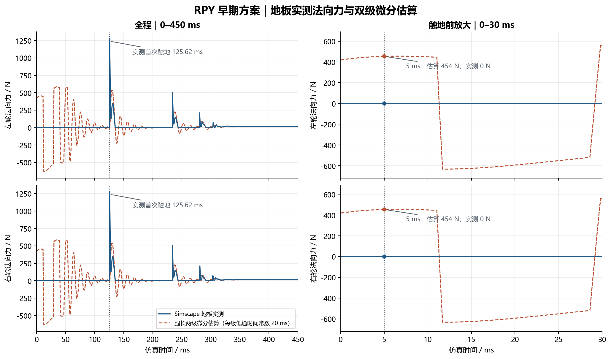
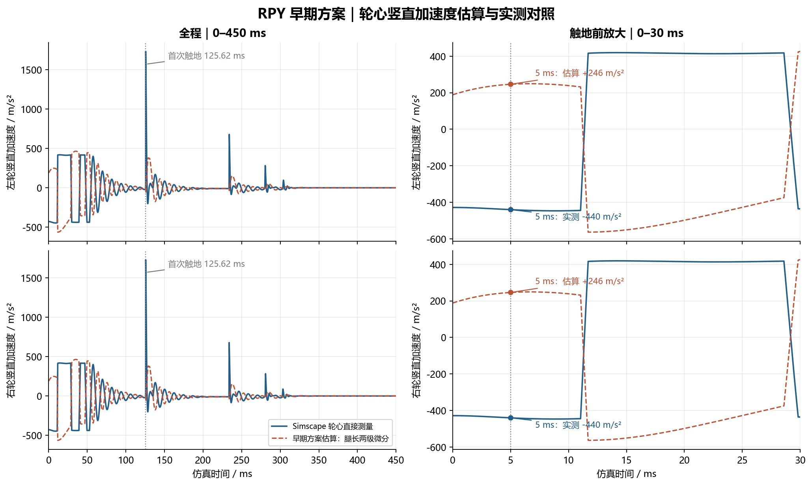
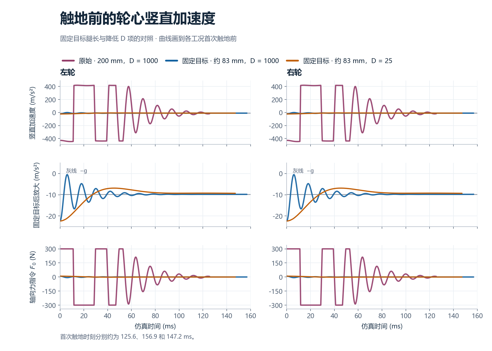
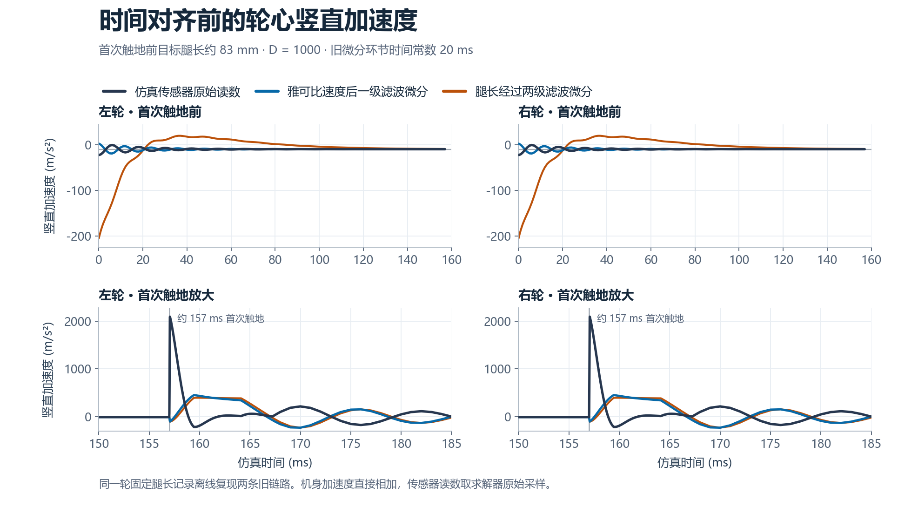
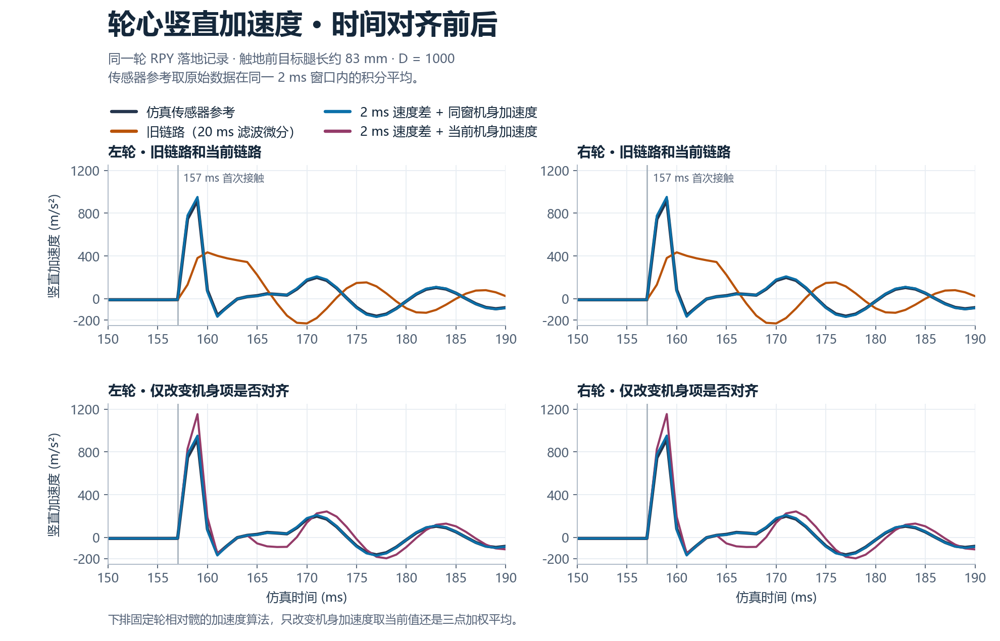
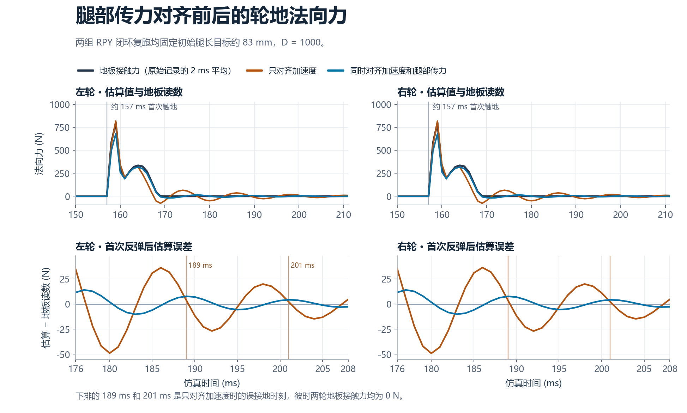
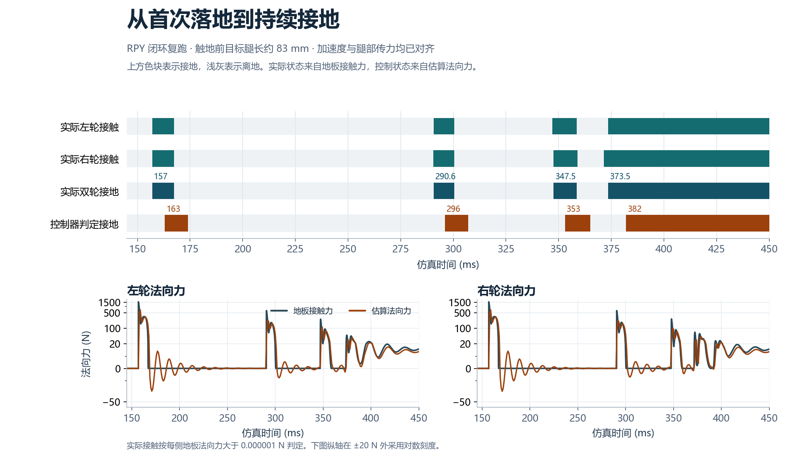
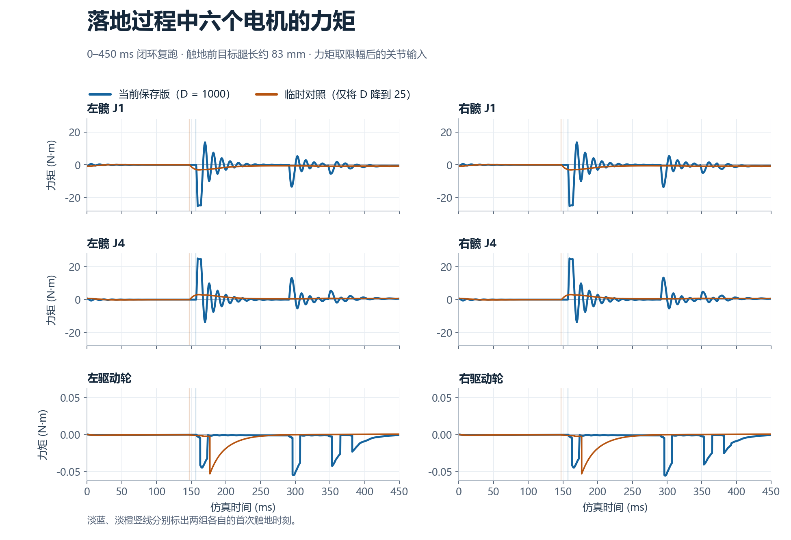

# 轮腿机器人学习日志（2026 年 11 月）

> 本文记录轮腿机器人 Simscape 建模、LQR 控制调试、轮地接触与法向力估计的学习过程。部分早期原因分析为当时的推测，后续日期记录了进一步排查与修正。

## 11-03｜运动学与 Simscape 入门

### 学习内容

- 再次学习轮腿的运动学及动力学，并开始学习使用 Simulink / Simscape 进行轮腿仿真。
- 已完成轮腿运动学部分的 Simscape 学习。

### 学习困惑

- Simscape 能否直接利用 SolidWorks 导出的模型快速搭建仿真？
- Simscape 的仿真可视化似乎不如 MuJoCo 直观，不过目前还没有系统了解 MuJoCo。

## 11-04｜动力学、传感器与坐标系

### 学习内容

- 学习轮腿动力学和传感器的 Simscape 建模。
- 认识了坐标系中的 F、B，刚体块中的 G、R，转动关节中的 F、B，以及接触力计算模块。
- 对整机运动学坐标系有了进一步认识。

### 学习困惑

- Simscape 的轮腿运动可视化和视角调整不太方便，尚不确定是使用方法不熟悉，还是工具本身在这方面不如其他仿真平台。
- 仿真得出的电机转矩相比达妙电机的转矩指标感觉很小。
- 一些独立工况（起跳、飞跃斜坡、抬腿等）不太方便组织。如果全部塞进同一个 Simscape 模型，会增加维护难度。

### 学习计划

- 仿真配重可能与实际打印件、机加工件的质量存在较大差异，继续估算实际零件质量。

## 11-05｜目标状态函数与仿真视角

### 学习内容

- 封装目标状态函数，通过修改目标值调整轮腿的目标状态。
- 创建摄像头，优化仿真视角。

### 学习困惑

- 将速度阶跃从 $-0.5\ \mathrm{m/s}$ 调整至 $-1\ \mathrm{m/s}$ 后，仿真耗时显著增长，超过 30 分钟。

### 初步排查

- 当时怀疑与 LQR 有关，尚未确认。
- 课设较累，当天休息。

## 11-06｜排查 −1 m/s 速度阶跃失衡

> **11-07 回顾：** 轮速和转矩异常可能只是“右轮卸载、左轮支撑”这一接触状态分化的结果；需要优先追查为何两轮的接触状态不同，以及如何解决。

### 学习内容与现象

重点排查从 $0$ 阶跃到 $-1\ \mathrm{m/s}$ 后的失衡现象：两侧驱动轮转矩朝相反方向迅速增大。

当时观察到：

- 阶跃指令下达后，机身俯仰角迅速增大。
- 左右轮速逐渐产生较大偏差，甚至出现正负相反的速度误差。
- 随后轮地接触状态改变，两轮驱动转矩异常增长。

### 1. 关于转矩持续增大的初步分析

以左轮为例，目标速度为 $-1\ \mathrm{m/s}$，当时测得左轮速度为 $-1.266\ \mathrm{m/s}$，控制律为：

$$
\boldsymbol u=K(\boldsymbol x_d-\boldsymbol x)
$$

当时观察到 LQR 给出的驱动转矩目标 $T$ 为负，因此轮速可能继续朝负方向增加。最初将这一现象描述为“正反馈增加”，后续需要结合全部状态反馈及实际接触状态判断，不能仅根据速度误差单项下结论。

### 2. 左右轮速出现明显差异的原因（当时分析）

- 在 $2\ \mathrm s$ 下达速度指令前，两轮速度误差很小。
- 下达 $-1\ \mathrm{m/s}$ 指令后，轮速差并未立即明显增大。
- 随着机身俯仰角增大，两侧髋关节 J1 角度迅速变化。
- 右侧 J1 先触及约 $106^\circ$ 的机械限位，产生限位反力矩，轮地法向力和两侧响应开始明显分化。
- 左侧 J1 随后也触及限位，进一步影响响应。

### 3. 两轮相对目标速度出现正负偏差的原因（当时假设）

右侧髋关节触限后，髋部与左右腿的竖向相对运动不同。曾推测左轮向下伸展较快，导致右轮卸载、左轮支撑，最终又使两轮都出现短暂离地。

> 当时的描述中对哪条腿支撑、哪条腿悬空存在口误与不确定性。后续以法向力、轮地间隙和关节限位记录为准。

### 4. 俯仰角快速增加的初步解释

当时认为速度阶跃使 LQR 输出增大，进而引起机体俯仰角加速度增加，并参考原动力学推导中的式（1.9）。这只是初步解释，具体应结合动力学各项和控制器输出验证。

### 5. 限位反力矩及法向力

- **限位反力矩：** 当 J1 到达机械限位且仍有继续越限的运动趋势时，关节限位约束产生阻止越限的反作用转矩。
- **法向力异常：** 当时怀疑关节快速触限，引起机构冲击和轮地法向力变化。不能简单等同于“限位反力矩越大，法向力一定越大”。

### 6. 异常工况下的轻量化仿真

```matlab
cfg = set_state_ref();
cfg.stopTime = 2.5;
cfg.showAnimation = false;
out = runScenario(cfg);
```

### 模型认知

已确认所有电机转轴平行，便于统一理解关节正方向；但左右关节实际运动是否同向，仍需结合各自坐标定义判断。

### 初步排查与学习困惑

- 怀疑约束机体横滚自由度可能放大左右腿微小响应差异，并引发异常的轮地载荷分配。
- 解锁横滚自由度后，模型可能侧翻。
- 即使没有侧翻，轮子速度反馈与车身对地速度仍严重偏离。

## 11-07｜几何参数修正与左右轮响应排查

> **重要发现：** VMC（原记录作 VMX）使用的两髋电机轴距为 **8 cm**，与 `.slx` 模型原设置的约 **6.7 cm** 不一致。经结构件核对，实际应为 8 cm，已同步修改仿真模型。

### 学习思考

针对 $-1\ \mathrm{m/s}$ 速度阶跃失衡，继续沿两个方向排查：

1. **限制横滚时：** 左右腿的微小响应差异为什么会演化为单轮先卸载及双轮离地？如何缓解？
2. **解除横滚限制后：** 机身为何会侧翻？需要增加哪些控制策略？

### 学习内容

- 收紧求解器精度和最大步长后，左右腿的响应基本一致，不再出现此前持续扩大的左右差异。
- 仍观察到以下运动链条：关节触限 → 腿长变化 → 支持力增大、轮子压向地面 → 支持力随后下降至零 → 短暂腾空 → 在重力作用下重新负载。

### 学习发现

送入 LQR 的纵向速度状态应与模型定义保持一致。编码器直接提供的是轮子相对支架的旋转信息，不能直接当作轮子对地速度，需要结合支架相对机身的运动和机身运动进行换算。

### 仿真现象

- $0\rightarrow1\ \mathrm{m/s}$ 的速度阶跃已能跟踪，但响应效果仍不理想。

## 11-08｜LQR 权重与轮速反馈优化

### 学习内容

调整 $Q,R$ 矩阵，优化速度阶跃响应；同时将 LQR 输入的轮速从电机相对支架的速度，修改为换算后的轮对地速度。

### 1. 参数调整

```matlab
% 原参数
Q = diag([1 0.07 10 5 300 0.6]);
R = diag([20 1]);

% 当前参数
Q = diag([20 0.2 0.03 5 300 0.6]);
R = diag([100 10]);
```

### 2. 响应对比

- 本次响应优化主要来自 $Q/R$ 权重调整。
- 补偿支架角速度对阶跃响应的改善不算明显。

### 3. 角速度补偿前后

补偿支架对地角速度后，送入 LQR 的轮对地速度与预期物理量更加一致。

### 4. 各权重变化的含义

| 状态或控制量 | 旧值 → 新值 | 理解 |
|---|---:|---|
| $\theta$ | 1 → 20 | 更重视虚拟摆杆倾角偏差 |
| $\dot\theta$ | 0.07 → 0.2 | 更不愿出现较大的摆杆角速度 |
| $x$ | 10 → 0.03 | 更能容忍位置误差，减弱追赶目标位置的倾向 |
| $\dot x$ | 5 → 5 | 速度误差权重不变 |
| $\phi$ | 300 → 300 | 机体俯仰角误差权重不变 |
| $\dot\phi$ | 0.6 → 0.6 | 机体俯仰角速度权重不变 |
| $T$ | 20 → 100 | 更不愿使用较大的轮端转矩 |
| $T_p$ | 1 → 10 | 更不愿使用较大的虚拟腿转矩 |

> 以上是代价函数权重的直观含义。实际闭环响应取决于重新求得的整个反馈增益矩阵，不能简单看作某一个状态增益按同一比例变化。

### 5. 自由度调整

- 通过 6-DOF 相关设置解锁横滚角、偏航角。
- 解锁后仿真速度大幅下降。

### 学习困惑

1. GPT 辅助调节 $Q/R$ 的具体依据是什么？如何高效寻找合适的 $Q/R$？
2. `.slx` 仿真中很多工况需要手动搭建，是否有更方便的平台？

### 学习计划与前瞻

- 修改模型以支持偏航和横滚运动。
- 逐步实现转向控制和横滚角补偿。
- 计划下一天尝试转弯（可能需要先布置场地）。

## 11-09｜BOM 与转向、横滚控制

### 学习内容

- 确认 BOM 清单，准备购买实物。
- 继续推进偏航与横滚补偿仿真。

## 11-10～11-15｜阶段间隔

因课设和感冒影响，项目推进暂缓。

## 11-16｜复工与离地判断

### 学习内容

- 复工，当前精力和效率仍未完全恢复。
- 建立驱动轮法向支持力估计器、空中姿态控制器和偏航控制器。

### 发现的问题

- 落地过程中，多次错误触发离地信号。

## 11-17｜轮地法向力估计与落地控制排查

### 学习内容

排查落地过程中反复触发离地信号的原因，并改进轮心竖直加速度和轮地法向力估算。

### 一、法向力估算的物理模型

当前以轮地法向支持力作为触地、离地判断依据。参考《RoboMaster 平衡步兵机器人控制系统设计》第 14 页，轮子竖直方向受力满足：

$$
F_N-P-m_wg=m_w\ddot z_w
$$

其中腿部机构对驱动轮竖直向下的力近似为：

$$
P\approx F\cos\theta+\frac{T_p\sin\theta}{L_0}
$$

轮心高度关系为：

$$
z_w=z_M-L_0\cos\theta
$$

对时间求两次导数：

$$
\begin{aligned}
\ddot z_w
&=\frac{\mathrm d^2}{\mathrm dt^2}(z_M-L_0\cos\theta)\\[6pt]
&=\frac{\mathrm d}{\mathrm dt}
\left(\dot z_M-\dot L_0\cos\theta+L_0\dot\theta\sin\theta\right)\\[6pt]
&=\ddot z_M-\ddot L_0\cos\theta
+2\dot L_0\dot\theta\sin\theta
+L_0\ddot\theta\sin\theta
+L_0\dot\theta^2\cos\theta
\end{aligned}
$$

由受力方程可进一步估算：

$$
F_N\approx P+m_wg+m_w\ddot z_w
$$

但与仿真测量结果对比，最初存在明显偏差。



### 二、排查过程

#### 1. 发现轮心竖直加速度误差

对比按运动学重建的轮心竖直加速度与仿真直接测量的轮心竖直加速度，发现：

- 对腿长进行两级滤波微分所得到的加速度存在明显偏差，表现为滞后、冲击幅值偏低。
- 左右轮在首次触地前的竖直加速度曾反复震荡，推测与腿长反复变化有关。



#### 2. 用雅可比计算腿长速度，减少微分链路

参考该文档第 7 页的五连杆运动学关系（也是 VMC 所需的运动学基础）：

$$
\boldsymbol x=f(\boldsymbol q)
$$

其中：

$$
\boldsymbol x=\begin{bmatrix}L_0\\\phi_0\end{bmatrix},\qquad
\boldsymbol q=\begin{bmatrix}\phi_1\\\phi_4\end{bmatrix}
$$

全微分：

$$
\delta L_0=
\frac{\partial f_1}{\partial\phi_1}\delta\phi_1+
\frac{\partial f_1}{\partial\phi_4}\delta\phi_4
$$

因此利用雅可比可以由关节角速度求腿长速度：

$$
\dot L_0=
\frac{\partial f_1}{\partial\phi_1}\dot\phi_1+
\frac{\partial f_1}{\partial\phi_4}\dot\phi_4
$$

轮心相对髋部的竖直速度为：

$$
\begin{aligned}
v_{\mathrm{rel}}
&=\frac{\mathrm d}{\mathrm dt}(-L_0\cos\theta)\\
&=-\dot L_0\cos\theta+L_0\dot\theta\sin\theta
\end{aligned}
$$

使用 **2 ms 的速度差分**估计轮心相对髋部在该窗口内的平均竖直加速度，避免继续对腿长进行两级滤波微分。

#### 3. 减少首次落地前的腿长震荡

针对触地前的反复震荡：

- 固定首次落地过程中的目标腿长。
- 降低腿长 PD 控制器的 D 项。

调整后，触地前左右轮加速度波形更接近预期的自由落体表现。



#### 4. 对比固定腿长后的加速度估计



观察到：

- 触地前，使用雅可比求相对速度、再做一阶差分，估算值与仿真实测值较接近。
- 触地后，原有处理方式仍出现明显差异。

**二阶差分初始条件问题：** 如果腿长二阶差分的内部初值设置为零，而仿真初始腿长并不为零，就可能在启动时产生虚假的大幅速度、加速度响应。将初值设为初始腿长可以消除这种初始化造成的假瞬态。

#### 5. 时间对齐：机身加速度与相对加速度采用同一 2 ms 窗口

原方法将“当前时刻的机身竖直加速度”与“经过滤波、存在滞后的相对加速度”直接相加。触地时两项快速变化且可能方向相反，时间错位会使本应抵消的部分无法正确抵消。

因此，统一采用最近 **2 ms** 的时间窗：



**5.1 机身竖直加速度：1:2:1 三点加权平均**

$$
\overline{\ddot z}_M[k]=
\frac{\ddot z_M[k-2]+2\ddot z_M[k-1]+\ddot z_M[k]}{4}
$$

**5.2 轮心相对髋部的竖直加速度**

由：

$$
z_w-z_M=-L_0\cos\theta
$$

计算相对竖直速度，其中 $\dot L_0$ 由雅可比得到：

$$
v_{\mathrm{rel}}[k]=
-\dot L_0[k]\cos\theta[k]+
L_0[k]\dot\theta[k]\sin\theta[k]
$$

随后在整个 2 ms 窗口内做一次速度差分：

$$
\overline a_{\mathrm{rel}}[k]=
\frac{v_{\mathrm{rel}}[k]-v_{\mathrm{rel}}[k-2]}{2T_s}
$$

其中采样周期 $T_s=1\ \mathrm{ms}$。

**5.3 轮心竖直加速度估计**

$$
\boxed{
\underbrace{\overline{\ddot z}_w[k]}_{\text{轮心竖直加速度估计}}=
\underbrace{
\frac{\ddot z_M[k-2]+2\ddot z_M[k-1]+\ddot z_M[k]}{4}
}_{\text{机身竖直加速度的三点加权平均}}+
\underbrace{
\frac{v_{\mathrm{rel}}[k]-v_{\mathrm{rel}}[k-2]}{2T_s}
}_{\text{轮心相对髋部的平均竖直加速度}}
}
$$

该结果对应 **$[k-2,k]$ 时间窗的平均加速度**，不是第 $k$ 拍的瞬时加速度。

#### 6. 腿部传力同样进行时间对齐

即使轮心竖直加速度已经尽可能接近参考值，法向力估算仍有一定差异。因此继续将腿部传力项 $P$ 对齐到相同时间窗口。



#### 7. 重新检验轮地接触判定

统一轮心加速度和腿部传力的时间窗口后，法向力估算与仿真实测更加接近。再次验证落地、离地检测，未再观察到此前异常的反复切换现象，当前仿真工况下接触判定效果较好。



### 学习困惑

- 当前法向力估算在仿真中已较准确，但尚未评价其对传感器噪声的容忍度。
- 后续需学习其他工程如何实现空中姿态控制和落地控制。

### 学习总结（新增）

通过改进法向力估算，同时降低虚拟腿轴向力 $F$ 控制器的 D 项，降低了落地阶段的阻尼作用强度，使机器人从落地到稳定过程中电机转矩峰值大幅下降。



这也从当前仿真工况侧面表明：**目前结构与控制参数下，达妙电机的转矩能力仍具有一定余量。** 不过，这不等于已经完成全部工况的电机选型验证；后续还需检查连续转矩、转速—转矩曲线、温升和更高动态工况。

---

## 后续待验证事项

- 法向力估计器对关节角、关节速度和 IMU 噪声的敏感性，以及 2 ms 差分的噪声放大。
- 接触瞬态下，窗口平均法向力与真实瞬时接触力的区别。
- 空中姿态控制与落地缓冲的控制策略。
- 解除更多自由度后仿真变慢的原因与轻量化运行方式。
- 在真实质量、惯量及电机能力约束下重新检验转矩余量。
